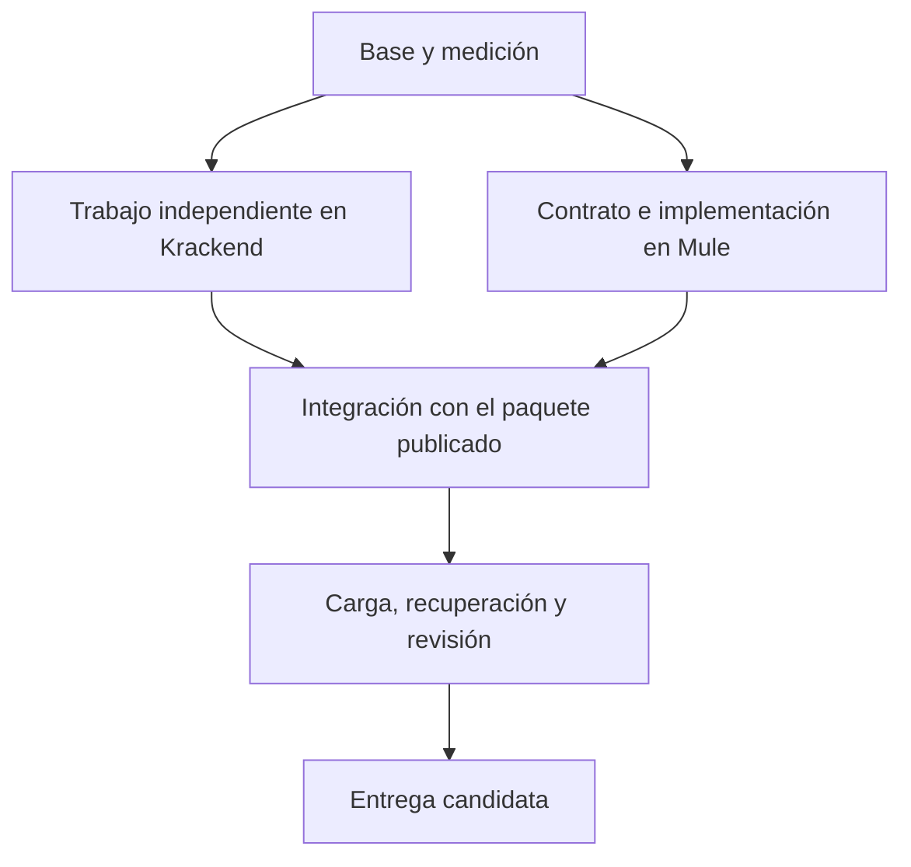

# Plan de trabajo: concurrencia de Krackend y su integración con Mule

**Estado:** implementación autorizada y en curso. Fanout desacoplado y protección de resultado tras pérdida de lease implementados y verificados; integración cooperativa con Mule y aceptación de carga pendientes.

**Pausa solicitada antes de nuevos cambios:** el [plan completo del 19 de noviembre](concurrency-complete-remediation-plan-20261119.md) reúne la corrección de recepción, coordinación, publicación, integración con Mule 2.4.0 y aceptación con carga. El usuario revisará ese plan antes de modificar código o versiones. Las referencias de fuentes siguen en 2.3.2; las notas históricas de este documento sobre falta de API corresponden a la inspección anterior a la publicación de 2.4.0.

**Prioridad actualizada:** el [plan de independencia entre sagas y contención con un solo host](concurrency-single-host-remediation-plan.md) concreta el orden siguiente a partir del nuevo error y de la referencia Errs. La condición principal es que A esperando no monopolice los ejecutores que B necesita. Incluye diagnóstico del propietario, liberación del lease antes de activación/publicación y conservación durable del trabajo pendiente.

## Objetivo

Eliminar el bloqueo entre instancias provocado por mensajes que consumen ejecutores esperando su turno o un lease. Evitar que una cola de activación llena prolongue la operación del productor. Conservar durabilidad, idempotencia, recuperación y consistencia de las transiciones de cada saga.

El caso reportado es una carga de 50 mensajes que tardó 38 minutos en drenarse. Las reproducciones actuales confirman mecanismos de bloqueo entre instancias y acoplamiento al encolado; todavía no reproducen cuantitativamente esa duración con la composición desplegada.

## Trabajo ya disponible

| Entregable | Estado |
|---|---|
| [Diagnóstico y evidencia](concurrency-root-cause-audit-20261118.md) | Elaborado; incluye límites de las reproducciones |
| [Requerimiento de Mule](mule-cooperative-scheduling-requirements.md) | Elaborado; contrato público aún propuesto |
| Reproducción de contención, fanout lento y flush inconsistente | Ejecutada con dependencias controladas |
| Reproducción de bloqueo entre A y B usando el executor de Mule | Ejecutada con dos puestos de ejecución y tres scopes distintos |
| Reproducción de commit notifier bloqueado por cola llena | Ejecutada |
| Correcciones en código de producción | Fanout y resultado tras pérdida de lease implementados; bloqueo principal pendiente de Mule |
| Regresiones enfocadas de coordinación y notificaciones | 26 casos aprobados contra proyectos de producción mediante runner en proceso |
| Validación del host real con 50 mensajes | Pendiente |

## Secuencia y dependencias

Las fases K1-K4 pueden adelantarse mientras se trabaja en Mule. La integración I1-I3 y la aceptación final dependen de su contrato y sus paquetes publicados. No se reemplazará ese contrato por APIs ficticias ni por un segundo scheduler permanente en Krackend.

## B0. Establecer la base de trabajo y de medición

**Dependencia:** inicio de la implementación autorizada.

### Trabajo

1. Conservar los informes y reproducciones existentes, confirmar el estado del checkout y trabajar en una rama local correspondiente a la base acordada.
2. Resolver el acceso de escritura a la metadata Git mediante un entorno de trabajo permitido antes de cambiar de rama o hacer commits. Actualmente el checkout local sigue en `codex/work-20261118`; la rama remota de diagnóstico existe, pero el fetch/cambio local fue bloqueado. No confundirlos.
3. Confirmar las versiones realmente restauradas y las de la imagen desplegada. Los binarios locales de pruebas inspeccionados contienen Mule 2.2.0 aunque el código fija 2.3.2; no usar `--no-build` sobre ellos para validar el código actual.
4. Registrar las opciones efectivas de Pigeon, Service Bus y cada lane de Mule; número de réplicas, límites de CPU/memoria, timeouts y configuración de recuperación.
5. Capturar una línea base con una instancia y definir la carga reproducible de 2, 3, 10, 20 y 50. Separar tiempo en recepción, espera en cola, lease, decisiones/persistencia, publicación y respuesta del servicio remoto.
6. Preparar un entorno donde puedan ejecutarse las pruebas de integración con EF, Redis y el broker correspondiente. En la sesión de diagnóstico no hubo Docker operativo y VSTest no pudo conectarse a testhost; son verificaciones pendientes, no resultados aprobados.

### Entregable y cierre

Ficha de versiones/configuración, escenario de carga y métricas base. Antes de ajustar capacidad se deja escrito qué latencia y throughput se usarán para aceptar el cambio. Los límites de seguridad de una prueba no se presentarán como un SLA de producción.

## K1. Sacar el fanout opcional de la ruta de mutación

**Dependencia:** B0 para implementación/verificación. No depende del nuevo Mule.

### Trabajo

- Revisar `SignalRRuntimeReactiveEventPublisher`, su queue/dispatcher y la publicación posterior al commit de `RuntimeStorageUnitOfWork`.
- Hacer que la operación de negocio solo entregue una notificación a un mecanismo acotado. El envío a Redis u otros clientes no debe ejecutarse como una espera de red dentro de esa operación.
- Mantener el orden de publicación posterior al commit y no publicar eventos de una transacción revertida.
- Definir overflow y resynchronización para las notificaciones opcionales. Las filas durables de negocio siguen siendo la fuente de verdad.
- Mantener capacidad y shutdown acotados; evitar una tarea nueva sin límite por evento y evitar capturar servicios scoped en trabajo que los sobreviva.

### Pruebas y cierre

Con el fanout retenido en una barrera o fallando, la mutación confirma y libera su lease antes de desbloquearlo. La UI local sigue recibiendo actualizaciones y puede reconciliar después de un overflow o desconexión. No crece una cola ilimitada.

## K2. Preparar los resultados y las reglas de coordinación de Krackend

**Dependencia:** B0. El diseño y las pruebas del core no dependen del tipo público final de Mule.

### Trabajo

- Delimitar resultados internos de operación terminada, sin trabajo aplicable, aplazamiento esperado y fallo real. No acoplar el core a tipos de Mule.
- Distinguir motivos de aplazamiento: lease ocupado, callback todavía no procesable y respuesta aceptada pendiente de procesamiento. Un callback obsoleto o ya resuelto no debe reintentarse para siempre.
- Revisar la duración del lease y qué operaciones lo conservan. Acotar las secciones de mutación y sacar I/O opcionales; una publicación de comando no se moverá fuera de su protección sin definir antes su transición durable y el tratamiento de entrega incierta.
- Preparar una adquisición sin sondeo prolongado para la futura ruta cooperativa. No cambiar globalmente la semántica de todos los llamadores mientras sus adapters aún no entienden Deferred.
- Revisar la pérdida de propiedad: la cancelación por pérdida del lease no debe terminar reportando éxito. Distinguir esa detección del fencing persistente necesario para impedir escrituras de un propietario anterior.
- Definir el mapa de clave: callback, dispatch y timeout de una instancia usan el mismo namespace de instancia; un trigger sin instancia usa identidad de inicio/idempotencia. Una correlación de negocio compartida no convierte varias sagas en una sola clave.

### Pruebas y cierre

Resultados y reglas verificables sin modificar el scheduler de Mule: reentrada válida en el mismo scope, scopes independientes, instancia distinta disponible, pérdida de propiedad y repetición idempotente de resultados ya persistidos. El código que dependa de la nueva capacidad no se activa sin su integración.

## K3. Medir y reducir el coste de recepción

**Dependencia:** B0. Puede hacerse en paralelo con Mule y K1–K2.

### Trabajo

- Medir el recorrido de `PigeonIngressAdapter`, que actualmente relee las configuraciones activas antes de resolver los destinos de cada mensaje.
- Preparar resolución selectiva por endpoint/versión o la alternativa justificada por la medición. Si se introduce cache, definir su generación e invalidación; no conservar triggers retirados o rutas obsoletas.
- Revisar las opciones efectivas del consumidor y la separación entre aceptar/persistir un mensaje y ejecutar sus decisiones. No asumir que un scope propio elimina la espera de un presupuesto compartido de recepción.
- Preservar las reglas de aceptación durable de callbacks y su relación con el deadline. No quitar simplemente el lease de recepción ni adelantar el acknowledgement sin conservar la atomicidad necesaria frente a un timeout.
- Mantener compatibilidad con rollout, rollback, versiones archivadas y consumidores compartidos.

### Pruebas y cierre

Demostrar el coste de recepción antes/después y que no se acepta trabajo para una ruta inactiva. Las respuestas aceptadas a tiempo mantienen su protección; los mensajes no confirmados conservan la redelivery correspondiente. Una optimización sin mejora medida no se incorpora al arreglo principal.

## K4. Preparar la batería de regresión y carga

**Dependencia:** B0. Puede prepararse antes de que termine Mule.

### Trabajo

- Convertir las reproducciones diagnósticas en pruebas que exijan el comportamiento corregido, en lugar de esperar que el defecto ocurra.
- Construir casos con las mismas instancias, tipos de acciones y composición del host, sin sustituir el scheduler por un dispatcher que solo registra llamadas.
- Añadir barreras para mantener A ocupada y comprobar progreso de B. Conservar el límite de ejecutores del escenario; no hacer pasar la prueba aumentando capacidad.
- Preparar cargas de 1, 2, 3, 10, 20 y 50 instancias y una distribución con una instancia caliente y varias de poco trabajo.
- Preparar las ventanas de caída, redelivery y respuesta temprana descritas en la matriz de aceptación.
- Separar pruebas deterministas de comportamiento de mediciones de rendimiento con infraestructura real.

### Entregable y cierre

Pruebas y escenarios listos para integrar. Los casos que requieren Deferred se identifican como pendientes hasta que exista el paquete correspondiente; mocks y snapshots no se cuentan como una validación del nuevo Mule.

## M0. Contrato y entrega de Mule — trabajo externo paralelo

**Entrada:** [mule-cooperative-scheduling-requirements.md](mule-cooperative-scheduling-requirements.md).

### Entrega que se necesita

1. Clave de ejecución optativa y selección de trabajo elegible antes de ocupar ejecutores, con equidad entre instancias y coordinación entre los lanes configurados.
2. Resultado Deferred durable sobre la misma acción, sin consumir intentos de fallo ni convertir contención en una excepción ordinaria.
3. Activación inmediata que no bloquee al productor después de persistir, con recuperación de señales omitidas.
4. Semántica implementada en los providers usados, incluida la coherencia de claims y flush de FastLane.
5. Contrato público final, ejemplos compilables, pruebas, notas de actualización y versiones compatibles publicadas.

**Cierre:** revisar el contrato real y sus garantías. Una descripción de API sin paquete y sin pruebas de providers no habilita la aceptación de la integración.

## I1. Integrar la nueva capacidad publicada de Mule

**Dependencias:** M0 y K2/K4 preparados.

### Trabajo

- Restaurar y compilar las versiones compatibles de core Mule, EF e integración FastLane; comprobar el grafo real de dependencias.
- Configurar la clave de instancia para las acciones de Krackend correspondientes, incluidas las acciones persistidas antes del upgrade.
- Integrar el resultado de aplazamiento usando la API publicada, sin imitarlo marcando la acción completada o creando un mensaje nuevo.
- Asegurar que no se captura un coordinador/DbContext scoped desde un selector singleton ni desde una tarea posterior a la vida del scope.
- Validar capacidades al arrancar para detectar providers que no soporten la transición requerida.

### Cierre

El paquete restaura y compila; las acciones antiguas y nuevas se enrutan correctamente, conservando sus IDs y reglas de idempotencia.

## I2. Aplicar la coordinación cooperativa a trigger, callback, dispatch y timeout

**Dependencias:** I1 y K2.

### Trabajo

- Un intento que encuentra un lease ocupado solicita Deferred y retorna para liberar el ejecutor. No mantiene el puesto con un bucle de espera de dos segundos.
- Mantener el lease distribuido para proteger el estado entre réplicas; la clave local de Mule no lo sustituye.
- Procesar los triggers repetidos con su identidad de inicio; el aplazamiento no puede crear una instancia adicional.
- Distinguir un callback todavía no procesable de uno obsoleto y conservar la reanudación de resultados ya confirmados antes de una caída.
- Mantener la identidad y `CreatedOnUtc` del callback durable para no perder la protección de una respuesta aceptada antes del deadline.
- Tratar el timeout que espera procesamiento de respuesta como aplazamiento observable, sin una excepción ordinaria por cada intento.
- Verificar que una respuesta o confirmación tardía no degrada un dispatch ya resuelto y que las tareas remotas independientes pueden seguir trabajando en paralelo.

### Cierre

Una instancia ocupada no consume todos los ejecutores con sus competidores. Otra instancia con estado disponible avanza. Se mantienen exclusión, idempotencia, deadlines y presupuesto de errores funcionales.

## I3. Verificar activación, presión de colas y recuperación

**Dependencias:** I1–I2 y K1.

### Trabajo

- Adoptar la activación sin bloqueo de Mule sin duplicar permanentemente su scheduler dentro de Krackend.
- Verificar que un productor libera su lease aunque la cola inmediata esté llena y que el trabajo ya guardado se ejecuta por recuperación si se omite la señal.
- Verificar capacidad independiente de lanes para callbacks, comandos, deadlines, estadísticas y lifecycle.
- Revisar arranque con backlog y expiración/recuperación de leases. Readiness HTTP no es un mecanismo para pausar consumidores; cualquier coordinación de inicialización debe existir en el runtime.
- Evitar un gate global que espere que termine todo el backlog para permitir trabajar a instancias sanas.

### Cierre

No hay dependencia circular de encolado/lease, no se pierde trabajo por señales omitidas y el runtime recupera una carga activa después de reemplazar el proceso.

## V0. Matriz de aceptación integrada

| Caso | Evidencia obligatoria |
|---|---|
| A activa, muchos mensajes de A y una B | B entra antes de liberar A, con capacidad disponible y sin aumentar el presupuesto del escenario |
| Lease de A ocupado por otra réplica | Sus mensajes quedan pendientes; B progresa; la contención no consume intentos funcionales |
| 1, 2, 3, 10, 20 y 50 instancias | Throughput, duración y espera de cola medidos con la configuración declarada; no aparecen pausas de fallo de 30 s por contención normal |
| Tareas paralelas y callbacks cercanos | Se conservan todos los resultados y la saga no completa con trabajo pendiente |
| Respuesta temprana o confirmación de publicación tardía | No se pierde el callback ni se degrada un estado ya resuelto |
| Callback a tiempo frente a timeout | Una aceptación válida no se transforma en un timeout falso por el aplazamiento del propio runtime |
| Cola inmediata llena | El productor continúa después de persistir; el trabajo se recupera sin la señal original |
| Fanout lento, caído o con overflow | La mutación de negocio libera su lease; los clientes pueden reconciliar |
| Caída antes/después de Deferred y durante flush | La misma acción sigue recuperable; no queda una reserva abandonada irrecuperable |
| Dos réplicas y claim vencido | No hay mutaciones simultáneas no protegidas ni escritura del propietario viejo sobre el resultado nuevo |
| Fallo funcional después de varios aplazamientos | Se aplica su presupuesto de fallo real; los aplazamientos no lo agotan |
| Shutdown y redelivery | Cierre acotado, sin éxito falso ni pérdida de identidad para idempotencia |
| Carga sostenida con recursos del host | CPU, memoria, GC, colas y aplazamientos permanecen observables y acotados |

La medición final debe usar el broker y la composición del host desplegado, incluyendo UI/fanout cuando estén habilitados. Una prueba con HighThroughput, recursos diferentes o solo almacenamiento en memoria no reemplaza esa comprobación.

## E0. Entrega candidata y revisión

**Dependencia:** matriz V0 superada con resultados conservados.

- Revisar diffs y compatibilidad de contratos; documentar qué cambió, por qué y con qué evidencia.
- Preparar una versión candidata de Krackend con versiones exactas de dependencias y una guía de actualización para hosts.
- Documentar si existen migraciones, cómo actualizar escritores y cómo recuperar trabajo pendiente durante la transición.
- Preparar procedimiento de rollout/rollback compatible con los nuevos datos y comprobar límites de shutdown.
- Entregar resultados de carga y recuperación, limitaciones pendientes y trazabilidad de los escenarios.

La publicación o el despliegue no se consideran realizados por preparar el plan o el candidato. No se declara corregido el incidente completo solo porque las instancias eventualmente terminen.

## Orden operativo propuesto

1. B0: base, configuración efectiva y medición.
2. En Krackend: K1, K2 y K4; K3 se incorpora según la medición y sin retrasar la corrección principal.
3. En paralelo: M0, implementación y publicación del contrato en Mule.
4. Con el paquete disponible: I1, I2 e I3.
5. V0: aceptación con carga, proveedores reales y reemplazo de proceso.
6. E0: candidato revisable y evidencia de entrega.

No se asignan tiempos de calendario hasta confirmar la disponibilidad del contrato de Mule y del entorno de integración. Cada fase tiene un cierre verificable para evitar confundir preparación con una reparación terminada.

## Avance de implementación en Krackend

- K1 implementado: el publisher encola notificaciones opcionales sin esperar Redis; el dispatcher usa consumidores independientes para fanout remoto y SignalR local, ambos con buffers acotados. Se toma un snapshot sin payload y se solicita reconciliación ante overflow o fallo de envío. El proveedor Redis usa el mensaje `resync` existente.
- K2, protección de resultado, implementada: una operación que ignora la cancelación ya no obtiene éxito después de perder/fallar la renovación del lease. La cancelación del llamador tampoco se confirma como éxito. No equivale a fencing de todas las escrituras; esa aceptación requiere las pruebas distribuidas de V0.
- K4 avanzado: pruebas de regresión de cancelación, fallo de renovación, liberación del lease, 50 publicaciones con fanout bloqueado, overflow, snapshot y ausencia de eco entre réplicas. Se ejecutan contra proyectos de producción mediante un runner local que evita el socket de VSTest.
- Compilación de Runtime/WebUI y Gossip.Redis verificada con .NET 10, sin errores. Hay advertencias previas del repositorio.
- Validación local: 26 casos enfocados aprobados mediante el runner en proceso, usando las clases de prueba y proyectos de producción. Incluye las teorías de estado de sincronización y el nuevo mensaje explícito de reconciliación Redis. No se ejecutó la suite de infraestructura real: no hay Docker/K8s conectado y VSTest no pudo establecer su socket.
- La reproducción acotada de tres notificaciones pasó de retener el lease durante aproximadamente 3.3 s a liberar la operación en 33 ms y aceptar al siguiente mutador. Es una medición de control de flujo, no latencia de una saga completa.
- M0 e I1–I3 pendientes del contrato publicado de Mule. Los casos de bloqueo entre instancias por slots ocupados y notificación durable con canal lleno siguen siendo defectos abiertos; no se aumentaron workers ni se convirtió contención normal en trabajo completado.
- Verificación del proveedor: la última release publicada en GitHub sigue siendo Mule v2.3.2; `main` conserva un `MuleActionContext` sin aplazamiento cooperativo. No existe aún una API publicada contra la cual cerrar la integración.
